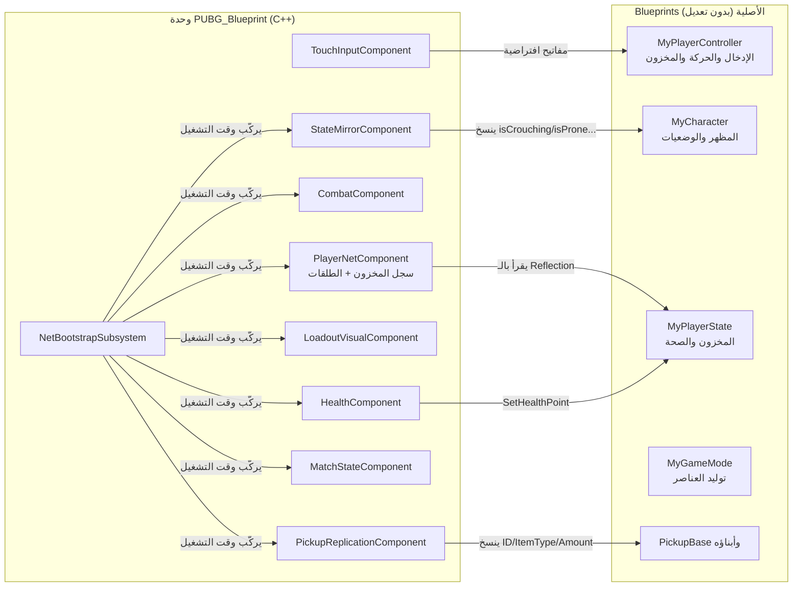
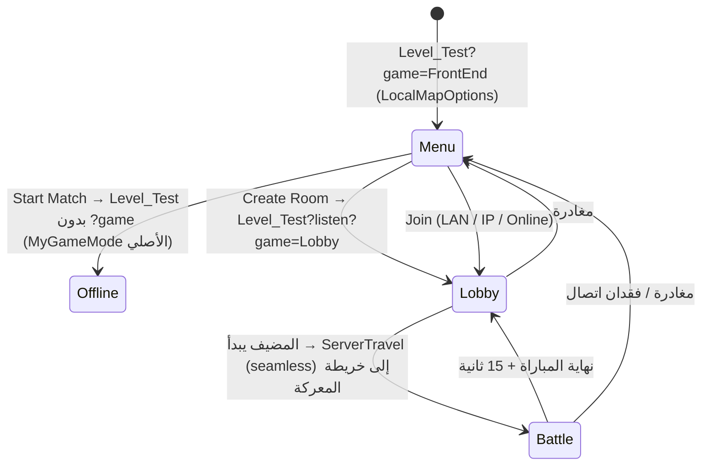

# معمارية طبقة اللعب الجماعي والهاتف

## 1. الفكرة الأساسية

المشروع الأصلي مبني بالكامل بـ Blueprint ومصمم للاعب واحد. بدلاً من إعادة كتابته، أضفنا **وحدة C++ واحدة** اسمها `PUBG_Blueprint` (وهو الاسم الذي كان المشروع يتوقعه أصلاً في `ActiveGameNameRedirects`) تعمل **فوق** الـ Blueprints الموجودة:

- **لم يُعدَّل أي ملف `.uasset` ولم يُغيَّر أب (Parent) أي Blueprint.**
- **وضع اللاعب الفردي (Start Match) يعمل كما كان تماماً**: طبقة الشبكة لا تُفعَّل إلا عندما يكون العالم خادماً شبكياً (Listen أو Dedicated).
- الأنظمة الجديدة (Lobby، القائمة الرئيسية، التحكم اللمسي، الإعدادات) مكتوبة بـ C++ وSlate، فلا تحتاج إلى أصول Widget أو خرائط جديدة.

## 2. خريطة الملفات

| المجلد | الصنف | الدور |
|---|---|---|
| `Core` | `UPUBGSettings` | كل الإعدادات (الخرائط، الحدود، أسماء متغيرات الـ Blueprint، القيم الافتراضية للأسلحة...) قابلة للتعديل من `DefaultGame.ini` أو Project Settings |
| | `PUBGBridge` | قراءة/كتابة متغيرات الـ Blueprint واستدعاء دوالها بالاسم، مع فحص النوع ورسالة تحذير واحدة عند غياب الاسم بدل الانهيار |
| | `PUBGItemData` | قراءة جداول `DT_Item_*` الأصلية (Damage, FiringInterval, ClipSize, UseAmmoID, Value/Limit...) |
| | `UPUBGGameUserSettings` | حفظ الرسومات/FPS/الحساسية/تخطيط الأزرار/الاسم |
| `Logic` | `PUBGNetLogic.h` | رياضيات مكافحة الغش والتحكم اللمسي **بدون أي اعتماد على Unreal** (مختبرة) |
| | `PUBGTouchLayoutDefaults.h` | التخطيط الافتراضي للأزرار كبيانات (مختبر على نسب شاشة 4:3 حتى 21:9) |
| `Sessions` | `UPUBGSessionSubsystem` | الغرف عبر Online Subsystem (LAN)، الانضمام بالـ IP، التنقل بين الخرائط، معالجة فقدان الاتصال |
| | `UPUBGRoomServiceSubsystem` | غرف الإنترنت عبر `Tools/RoomService` + Heartbeat الخادم + التحقق من تذاكر HMAC |
| `Lobby` | `APUBGLobbyGameMode/GameState/PlayerController/PlayerState` | غرفة الانتظار: كلمة السر، السعة، المضيف، الجاهزية، الشخصية، الطرد، العد التنازلي |
| | `APUBGFrontEndGameMode` | وضع القائمة الرئيسية |
| `Network` | `UPUBGNetBootstrapSubsystem` | يركّب مكونات الشبكة على الـ Blueprints الأصلية عند ظهورها على الخادم |
| | `UPUBGPlayerNetComponent` | (على MyPlayerController) لقطات المخزون، الطلقات، الإسقاط، السجل المرجعي على الخادم |
| | `UPUBGHealthComponent` | الصحة والطاقة والموت على الخادم |
| | `UPUBGCombatComponent` | التحقق من الطلقات وتطبيق الضرر وتأثيرات الإطلاق للآخرين |
| | `UPUBGStateMirrorComponent` | نسخ وضعيات الشخصية والسرعة والاتجاه + فحص السرعة |
| | `UPUBGLoadoutVisualComponent` | إظهار السلاح والخوذة والسترة والحقيبة والملابس للآخرين |
| | `UPUBGPickupReplicationComponent` | نسخ هوية العنصر الملقى للعملاء |
| | `UPUBGMatchStateComponent` | عدد الأحياء، سجل القتل، الترتيب، الفائز، العودة للّوبي |
| | `UPUBGPlayerProfileComponent` | بيانات اللاعب المعروضة (جاهز، مضيف، شخصية، حالة اتصال، قتلات) |
| `Mobile` | `PUBGTouchKeys` | المفاتيح الافتراضية `PUBGTouch_*` |
| | `UPUBGTouchInputComponent` | حالة الأزرار وحقن الإدخال وحفظ التخطيط |
| | `SPUBGTouchSurface / SPUBGTouchControls` | الرسم واللمس المتعدد ومحرر التخطيط |
| `UI` | `UPUBGUISubsystem` | يقرر أي واجهة تظهر في كل خريطة |
| | `SPUBGMainMenu`, `SPUBGLobbyPanel`, `SPUBGGameHud`, `SPUBGInGameMenu`, `SPUBGSettingsPanel` | الواجهات |

## 3. تدفق الخرائط بدون خرائط جديدة

لا يمكن إنشاء ملفات `.umap` بدون المحرّر، لذلك تُحمَّل الخريطة الموجودة `Level_Test` بأوضاع لعب مختلفة عبر خيار `?game=`:

يمكن لاحقاً إنشاء خرائط مخصصة فارغة للقائمة واللوبي وتغيير `MenuMap`/`LobbyMap` في `DefaultGame.ini` فقط.

## 4. نموذج السلطة (Server Authority)

| ما يقرره الخادم | كيف |
|---|---|
| الصحة، الضرر، الموت | `UPUBGHealthComponent` يستقبل الضرر فقط على الخادم عبر نظام الضرر في UE (`ApplyPointDamage` → `OnTakeAnyDamage`) |
| صحة الإصابة | الخادم يتحقق: سلاح موثّق في اليد، معدل الإطلاق (Token bucket من `FiringInterval`)، المخزن والتلقيم (`ClipSize`, `ReplaceClipTime`)، رصيد الذخيرة، قرب أصل الطلقة من اللاعب، تطابق نقطة الإصابة مع موقع الهدف مع تعويض محدود للتأخير، وخط رؤية بلا جدران. منطقة الرأس تُرفض إن لم تطابق ارتفاع الإصابة |
| مقدار الضرر | `Damage` من `DT_Item_Weapon` × مضاعف الرأس/الأطراف × تخفيض الخوذة/السترة الموثّقة |
| وجود العناصر وملكيتها | العنصر لا يصبح ملكاً للاعب على الخادم إلا إذا وُجد عنصر ملقى مطابق قريب منه، ويُحذف حينها للجميع (لا تكرار). العنصر المرفوض يُزال من حقيبة العميل |
| الذخيرة | رصيد لكل نوع = ما التُقط فعلاً؛ يُخصم مع كل طلقة مقبولة؛ لا يزيد أبداً من تقرير العميل |
| المستهلكات | الشفاء/الطاقة تُطبّق على الخادم من قيم `DT_Item_Health` (`Value`, `Limit`) و`DT_Item_Boost` مع احترام زمن الاستخدام |
| الإسقاط | الخادم يُنشئ العنصر الملقى الحقيقي (Replicated) فقط إذا كان اللاعب يملكه |
| الحركة | الكود الأصلي يحرّك الشخصية بـ `SetActorLocation`، لذلك يقبل الخادم موقع العميل لكنه يطبّق **فحص سرعة** (نافذتان متتاليتان فوق الحد ← إعادة اللاعب لآخر موقع موثوق) ويستثني السقوط الحر والمظلة. السرعة القصوى المقبولة محدودة بـ `MaxGroundSpeed` |
| نتيجة المباراة | `UPUBGMatchStateComponent` على الخادم: الأحياء، الترتيب، القتلات، الفائز، المغادرة = إقصاء |
| الدخول للغرفة | كلمة السر والسعة في `PreLogin`، وتذكرة HMAC قصيرة العمر للخوادم المخصصة، ورفض الانضمام بعد بدء المباراة |

**المضيف في Listen Server موثوق** (منطقه يعمل على الخادم نفسه) — هذا قيد طبيعي لنمط Listen Server، والحل الكامل هو الخادم المخصص.

## 5. كيف تُنسخ الأشياء للاعبين الآخرين

| الشيء | الآلية |
|---|---|
| الحركة والموقع | `CharacterMovementComponent` (مع قبول موقع العميل) |
| الاتجاه والسرعة | `StateMirror` يرسل Yaw/Velocity/MaxWalkSpeed ‏15 مرة/ثانية |
| الانحناء، الانبطاح، التصويب، حمل السلاح، السقوط الحر، المظلة، التلقيم... | `StateMirror` ينسخ متغيرات `MyCharacter` الأصلية، فيعرضها `MyAnimeBlueprint` كما هي |
| الإطلاق | صوت السلاح من `DT_Item_Weapon.FireSound` + مونتاج الإطلاق الأصلي + أثر الرصاصة `BulletHoleDecal` |
| إعادة التلقيم | مونتاج التلقيم الأصلي عند ارتفاع `isReload` |
| الموت | `isDead` → رسوم الموت الأصلية في AnimBP |
| السلاح في اليد/الظهر، الخوذة، السترة، الحقيبة، الملابس | `LoadoutVisual` من الجداول الأصلية على مقابس `MyGameInstance` الأصلية |
| العناصر على الأرض | `bReplicates` + `PickupReplication` (يصل ID قبل `BeginPlay` فيختار الـ Blueprint الشكل الصحيح) |
| الصحة في الواجهة الأصلية | `SetHealthPoint`/`SetEnergyPoint` على `MyPlayerState` للاعب المحلي |

## 6. التحكم اللمسي

- كل زر يحقن مفتاحاً افتراضياً (`PUBGTouch_Fire`...) مربوطاً في `DefaultInput.ini` **بنفس اسم الأمر الأصلي** (`Fire`, `Jump`, `Crouch`...). أي أن منطق الـ Blueprint الأصلي هو الذي ينفّذ كل شيء، والكيبورد والماوس ما زالا يعملان.
- عدّاد مراجع لكل مفتاح (زرّا إطلاق لا يُلغي أحدهما الآخر).
- عصا حركة عائمة أو ثابتة، منطقة ميتة، مشي بالدفع الخفيف، قفل الركض بدفع العصا للأعلى.
- سحب الكاميرا في أي مكان حر، وسحب زر الإطلاق/التصويب للتصويب أثناء الإطلاق.
- زر PICK UP يظهر فقط عند وجود عناصر قريبة (يقرأ `ItemsInRange` الأصلي) ويعرض اسم العنصر.
- عند فتح الحقيبة الأصلية تختفي الأزرار ويظهر زر CLOSE BAG حتى لا تعيق السحب والإفلات.
- محرر تخطيط: سحب، تكبير/تصغير، إخفاء/إظهار، إعادة ضبط، حفظ — ضمن المنطقة الآمنة (Notch).

## 7. الأداء على الهاتف

- مستويات Low/Medium/High/Ultra مضبوطة في `DefaultScalability.ini` (ظلال، مسافة رؤية، كثافة النباتات، ما بعد المعالجة، ذاكرة القوام).
- اختيار تلقائي أول مرة حسب فئة الجهاز (`Android_Low/Mid/High`).
- حد FPS ‏30/60/90/120 + دقة العرض 50–100%.
- الخريطة الكبيرة `Level_Battle` (≈2.6 GB أصول) مستبعدة من حزم الهاتف افتراضياً.
- العناصر الملقى بتردد تحديث شبكي منخفض (2Hz).
- الأزرار مرسومة بقوام يُنشأ برمجياً (لا أصول إضافية)، والواجهات كلها Slate خفيفة.
